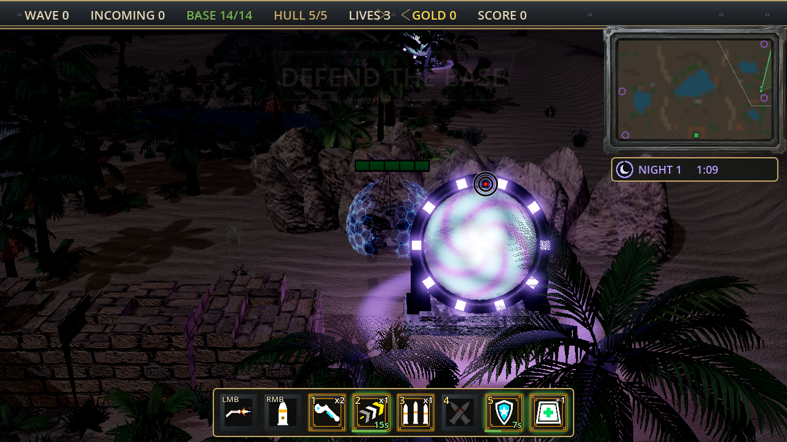
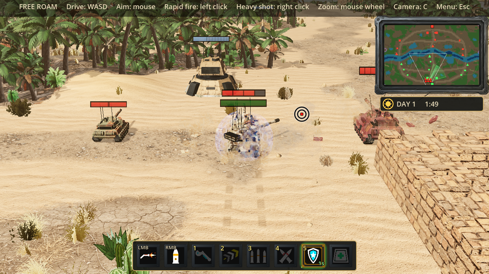
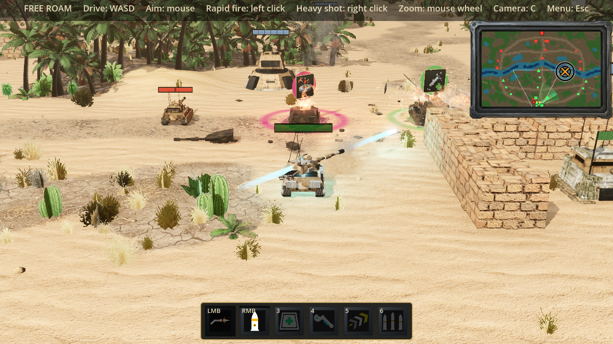
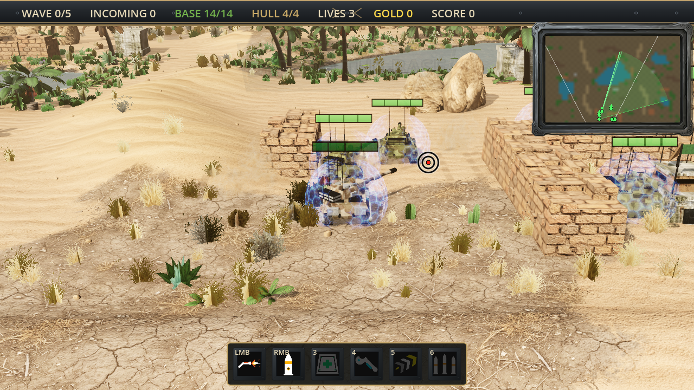
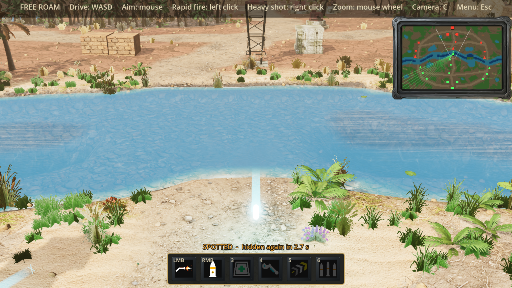
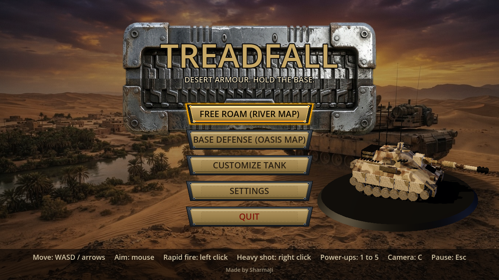

# Treadfall

A top-down tank battler built in Godot for **[GitHub Game Off 2026](https://itch.io/jam/game-off-2026)**. Theme: **SHIFT**.

**Play it in your browser:** https://mrsharmaji1301.itch.io/treadfall

## The Shift

Every few minutes the battlefield shifts from day to night. At night the fog closes in, you only see what your side can see, and hidden portals open across the map. Push in daylight, vanish into the dark.

## Modes

- **Base Defense**: hold your Command Centre against waves on the Oasis map.
- **Free Roam**: a huge river map with watch towers, turrets, artillery, hidden loot and an enemy base to break.
- **Multiplayer**: co-op lobbies (see [docs/ONLINE_PLAY.md](docs/ONLINE_PLAY.md)).

## Controls

| Action | Keyboard / mouse | Controller |
|---|---|---|
| Move | WASD or arrow keys | Left stick / D-pad |
| Aim | Mouse (or I J K L keys) | Right stick |
| Rapid fire | Left mouse or Space | Right trigger / RB / A |
| Special weapon | Right mouse, E or Shift | Left trigger / LB |
| Camera | C | |
| Pause | Esc | Start |

## Screenshots

| | |
|---|---|
|  |  |
|  |  |

## Run from source

1. Install [Godot 4.7](https://godotengine.org/).
2. Open Godot, choose **Import**, and select `project.godot`.
3. Press **F5**. The first start takes a minute or two while textures import.

More detail on how the game is put together: [docs/DEVELOPMENT.md](docs/DEVELOPMENT.md).

## AI disclosure

The code, much of the art and the text were made with heavy AI assistance, directed, reviewed and play-tested by the developer. Sound effects are from Pixabay. See [CREDITS.md](CREDITS.md).

## Credits

Made by SharmaJi.
